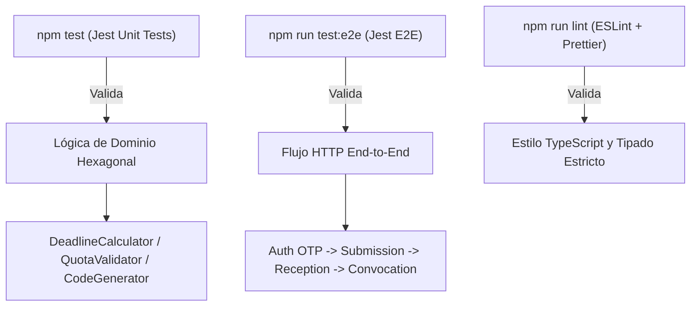

# Plan de Arquitectura y Diseño Técnico: Backend CEISH-ESPOCH

**Código de Especificación Activa:** `specs/001-flujo-mvp/spec.md` (v3.3.1)  
**Ubicación del Plan:** `specs/001-flujo-mvp/plan.md`  
**Estado:** Aprobado  

---

## 1. Estructura de Módulos (Arquitectura Hexagonal)

El sistema se estructura estrictamente en módulos limpios dentro de `src/modules/` y utilidades globales en `src/shared/`, respetando los principios 3 y 6 de la Constitución (`docs/doc_base/constitution.md`):

```text
src/
├── config/                         # Configuración centralizada (DB, Auth, Throttler)
├── shared/                         # Cross-cutting concerns
│   ├── db/                         # BaseOrmEntity (id, createdAt, updatedAt)
│   ├── decorators/                 # @Roles, @Permissions, @Audit, @Encrypt
│   ├── encryption/                 # EncryptionService (AES-256-CBC) & EncryptionTransformer
│   ├── enums/                      # Permission, Role, StudyType, ProtocolStatus
│   └── guards/                     # JwtAuthGuard, RolesGuard, PermissionsGuard
└── modules/
    ├── auth/                       # [RF-01, RF-10] Autenticación RBAC, JWT, OTP
    │   ├── domain/                 # Users, Roles, OTP Tokens
    │   ├── application/            # AuthService, UsersService, OtpService
    │   └── infrastructure/         # AuthController, UserOrmEntity, JwtStrategy
    ├── protocols/                  # [RF-02, RF-03, RF-06, RF-14, RF-19.1] Protocolos, Código Único, Versiones (v1.0->v2.0)
    │   ├── domain/                 # ProtocolEntity, VersionHistory, ThesisMetadata
    │   ├── application/            # ProtocolService, VersioningService, AtomicCodeGenerator
    │   └── infrastructure/         # ProtocolController, ProtocolOrmEntity
    ├── reception/                  # [RF-04, RF-05, RF-07, RF-08, RF-13, RF-18] Checklist, Subsanación 15d, Aceptación Explícita
    │   ├── domain/                 # ChecklistItem, ObservationalItem, AcceptanceRecord
    │   ├── application/            # ReceptionService, ChecklistService, DeadlineCalculator
    │   └── infrastructure/         # ReceptionController, ChecklistOrmEntity
    ├── documents/                  # [RF-04, RF-18.1] Gestión de Archivos y Plantillas
    │   ├── domain/                 # DocumentFile, TemplateUrl
    │   ├── application/            # DocumentService, StorageAdapter
    │   └── infrastructure/         # DocumentController, DocumentOrmEntity
    ├── evaluations/                # [RF-12, RF-19.2] Cuotas Evaluadores, Anexos 9/10, Informe Narrativo
    │   ├── domain/                 # EvaluationAssignment, RiskStratification, NarrativeReport
    │   ├── application/            # EvaluationService, QuotaValidatorService
    │   └── infrastructure/         # EvaluationController, EvaluationOrmEntity
    ├── resolutions/                # [RF-09, RF-17, RF-19.3] Convocatorias Pleno 001-2026, Oficios Quipux, Suspensión
    │   ├── domain/                 # PlenarySession, Resolution, QuipuxReference
    │   ├── application/            # ResolutionService, PlenaryService
    │   └── infrastructure/         # ResolutionController, PlenaryOrmEntity
    ├── notifications/              # [RF-08.1, RF-09.3, RF-15, RF-16.2] Envíos Email, Notificación EAG
    │   ├── domain/                 # NotificationLog, TemplateRenderer
    │   ├── application/            # MailerService, AlertService
    │   └── infrastructure/         # MailerAdapter, NotificationOrmEntity
    ├── follow-up/                  # [RF-15, RF-16, RF-17] Informes Avance/Final, Enmiendas, Eventos Adversos
    │   ├── domain/                 # FollowUpReport, AmendmentRequest, AdverseEvent
    │   ├── application/            # FollowUpService, AdverseEventAlertService
    │   └── infrastructure/         # FollowUpController, FollowUpOrmEntity
    └── ai-assistant/               # [RF-11] Asistente Virtual RAG sobre PET 2023
        ├── domain/                 # QueryContext, RAGResponse
        ├── application/            # AiAssistantService, VectorSearchAdapter
        └── infrastructure/         # AiAssistantController
```

---

## 1b. Matriz de roles fija (TSK-001.1)

**Requisitos:** HU-001 (puntos a–j) del spec v3.5.1, RF-001
**Módulo:** `auth` — `src/modules/auth/` (más `PermissionsGuard` en `src/shared`)
**División:** tres subtareas, un PR cada una, en este orden:

| Sub | Estado | Alcance |
|---|---|---|
| 1a | ✅ Hecho (PR #60) | Migración de la matriz fija y los datos; permiso por endpoint (HU-001 i); vigencia en sesión y guards (HU-001 j); pruebas E2E con el `PermissionsGuard` real; 12 mutaciones detectadas (MUT-1 a MUT-10 + MUT-2b + MUT-4b) |
| 1a.1 | ✅ Hecho (PR #61) | Vigencia en temporalRoles (login): exclusión de roles inactivos/eliminados y validación fecha_inicio > NOW() (HU-001 j); corrección down() para rol '43' (activo=false, eliminado_en=NULL) y ADMIN_TI (activo=true); 3 mutaciones detectadas |
| 1b | ✅ Hecho (PR #62) | Segregación (INVESTIGADOR excluyente) y una sola SECRETARIA vigente, en el registro y en la asignación de roles |
| 1c | ✅ Hecho (PR #63) | Retirar `RolesController` y `PermissionsController`, salvo GET /auth/roles (solo lectura, `USUARIOS_VER`, devuelve los 4 roles activos y sin `eliminado_en`); quitar `ADMIN_TI` y `'ADMIN'` del código, presets y pruebas; asistente IA solo `SECRETARIA`; eliminar `PERMISOS_GESTIONAR` del enum; `updateUserRoles` rechaza (400) códigos inexistentes, inactivos o con `eliminado_en` no nulo; limpieza de código muerto (`PermissionsController`, `RolesService`, `PermissionsService`, presets y DTOs sin importadores); vigencia con el reloj de la base (COALESCE con NOW()) en updateUserRoles |

### 1a — Alcance técnico

| Área | Cambio |
|---|---|
| Migración | Trabaja por códigos, nunca por ids. Aborta si no existe la cuenta de prueba que conserva SECRETARIA. Respalda `rol_permisos` en `catalogos.rol_permisos_bk_tsk001_1a`. Crea `USUARIOS_GESTIONAR`. Retira 5 permisos con `eliminado_en`. Siembra la matriz: SECRETARIA 35, PRESIDENTE 21, EVALUADOR 9, INVESTIGADOR 8; total 73. Desactiva solo las cuentas con ADMIN_TI vigente y después lo revoca. Deja SECRETARIA vigente en una sola cuenta. Marca ADMIN_TI y el rol basura. Quita ADMIN_TI de `allowed_roles`. Es idempotente. |
| `down()` | Restaura `rol_permisos` desde el respaldo, los 5 permisos, ADMIN_TI y el rol basura, y `allowed_roles`. No revierte `fecha_fin` ni `activo` de las cuentas (queda documentado). |
| Enum `Permission` | Agrega `USUARIOS_GESTIONAR`. `ROLES_ASSIGN`, `USERS_CREATE`, `USERS_EDIT` y `USERS_STATUS_TOGGLE` → `USUARIOS_GESTIONAR`. `PERMISSIONS_MANAGE` → `EVALUADORES_PERFILES`. `EVALUATORS_WORKLOAD_VIEW` → `REPORTES_CARGA`. `PERMISOS_GESTIONAR` se queda hasta 1c. |
| Sesión (login, `/auth/me`, refresh) | Una sola función arma los roles y permisos solo con lo vigente: `usuarios_roles` vigentes, roles activos y sin `eliminado_en`, permisos sin `eliminado_en`. |
| `PermissionsGuard` | La consulta filtra `p.eliminado_en IS NULL` y los roles activos sin `eliminado_en`. La caché de 5 minutos no cambia: después de migrar hay que reiniciar el backend. |
| `RolesGuard` | Sin cambios. Límite conocido: un token emitido antes de una revocación sigue valiendo hasta que vence; el refresh ya sale filtrado. |
| Pruebas | Unitarias: alias y función de vigencia. Migración: conteos, idempotencia, `down()` y aborto, con transacción y rollback. E2E con login real y el guard real, por rol, más los casos revocado, permiso retirado y cuenta desactivada. Mutaciones. |

> Los identificadores concretos (ids de cuentas) no van aquí.

### 1b — Alcance técnico

| Área | Cambio |
|---|---|
| Dominio | `SegregationOfDutiesDomainService` con funciones puras (`validateRoleChange` y `validateSingleSecretaria`), que reciben los datos ya cargados y validan el cambio de roles y la unicidad de SECRETARIA sin acceso a base de datos. |
| Aplicación | `updateUserRoles`, `createUser`, `updateUser` y `extendTemporaryRole` cargan los roles vigentes del usuario, los protocolos en curso como investigador (principal o co-investigador) y las asignaciones de SECRETARIA, y validan ANTES de escribir, dentro de la transacción. |
| Creación de usuario | `createUser` guarda el usuario y sus roles en la misma transacción; si falla la validación, no queda el usuario persistido. |
| Concurrencia | Asignar o prorrogar SECRETARIA bloquea la fila del rol SECRETARIA (`SELECT ... FOR UPDATE`) antes de revisar la unicidad para evitar condiciones de carrera. |
| Registro | `register` revisa cédula y correo antes de insertar, con 400 y mensaje claro ("Esta cédula ya está registrada" / "Este correo electrónico ya está registrado") evitando errores 500 por la restricción de cédula. |
| Pruebas y mutaciones | Pruebas unitarias de dominio para cada regla y superposición de períodos (sin fin, con fin anterior, programada a futuro); pruebas E2E con login real de Secretaría cubriendo todos los caminos y concurrencia con `Promise.all`; detección de al menos 10 mutaciones planeadas. |

---

## 1c. Creación del protocolo: borrador, envío, edición, fecha de recepción, título, auditoría y requisitos (TSK-001.5 a TSK-001.14)

**Requisitos:** HU-002, RF-02.1 a RF-02.8, RF-03.3, RF-NORM.1 (origen del plazo) y RF-EST.3 punto 5 del spec v3.7.0 (09/11/2026)
**Módulos:** `protocols`, `reception`, `audit` (interceptor en `src/shared/interceptors`), migraciones en `src/migrations`
**Flujo actual (verificado el 09/11/2026):** `POST /protocols` → `ProtocolsService.create` → `ReceptionService.iniciarRecepcion` (recepción en 9 con `fecha_recepcion = new Date()`, `reception.service.ts:437`) → `POST /protocols/:id/submit` → `updateReceptionStatus(id, 15)` sin validar el estado de origen (`protocols.service.ts:96-106`) → la Secretaría completa con `finalizarRevision` (`reception.service.ts:277`) o `verificarRequisitos` (`reception.service.ts:660`), que vuelven a escribir `fecha_recepcion = new Date()`.

| TSK | Orden | Estado | Alcance |
|---|---|---|---|
| 001.5 | 1 | Hecho (09/11/2026, 8779421) | Borrador invisible para la Secretaría y `submit` desde 9, 11 y 20 (RF-02.3) |
| 001.6 | 5 | Por hacer (desbloqueada: pendiente 13 cerrado el 09/11/2026) | `fecha_recepcion` NULL al crear, `NOW()` al enviar, sin pisar al completar; `fecha_constancia` al aprobar y como origen del plazo normativo (RF-02.4); migración de la columna y de datos |
| 001.7 | 2 | Hecho (09/11/2026) | `receptionStatus = BORRADOR` con recepción en 9 y versión 1 (RF-02.5) |
| 001.8 | 3 | Hecho (09/11/2026, 826142c) | Título con trim y 20 a 200 (RF-02.2) |
| 001.9 | 4 | Hecho (09/11/2026, e9f88e7) | `PROTOCOL_CREATED` con `registro_id` y sin cédulas ni teléfonos (RF-02.6) |
| 001.10 | 6 | Por hacer | Catálogo: CONFIDENCIALIDAD, CONFLICTO_INTERES y ANEXO_5 obligatorios en EI e IO (RF-03.3) |
| 001.11 | — | Para después (rediseño del frontend) | Ciclo del borrador: 8 días de calendario desde la creación, fecha de eliminación en pantalla, uno por investigador, descartar; solo versión 1 en 9 (RF-02.7) |
| 001.12 | — | Pendiente de confirmar (jueves 12/11/2026) | Tesis, `riesgoMayor`, formatos descargables (pendientes 11, 15 y 18) |
| 001.13 | — | Por hacer, aparte | Reconstrucción del catálogo de requisitos por `codigo_anexo` para bases nuevas (pendiente 17 cerrado) |
| 001.14 | 7 | Por hacer | `PATCH /protocols/:id` para editar el borrador (RF-02.8); depende de 001.5, 001.8 y 001.9; dependencia en el frontend (PUT → PATCH) |

### Alcance técnico por punto

| Punto | Cambio |
|---|---|
| Borrador (001.5) | `findProtocolsForReception` (`protocol.typeorm.repository.ts:50-75`) deja de incluir el 9: `pendientes` pasa de `IN (9, 15)` a `= 15`, y sin filtro se excluye `reception.statusId = 9`. `findAll` de `GET /protocols` excluye el 9 solo en el handler de la Secretaría/Presidencia (no en `mis-protocolos` ni `mis-subsanaciones`, que usan el mismo `findAll`: se pasa una opción desde el servicio). El CASE de etapa (`protocol-stage.sql.ts`) no cambia. `GET /secretaria/pendientes` ya usa solo el 15 (RF-ALR.f.1 a); no se toca. `ProtocolsService.submit` lee la recepción de la versión activa: acepta 9, 11 y 20; 409 (mensaje en español) en cualquier otro estado; la validación de propiedad del controlador no cambia. Reglas de estado en una función de dominio pura (p. ej. `assertCanSubmitDraft`), buscando antes equivalentes. |
| `fecha_recepcion` (001.6) | Migración: `ALTER COLUMN fecha_recepcion DROP NOT NULL, DROP DEFAULT`; `down()` rellena los NULL con `COALESCE(v.fecha_envio, p.creado_en)` y restaura `NOT NULL DEFAULT now()`. ORM: `nullable: true`, sin `default`, tipo `Date \| null`. `iniciarRecepcion` guarda `receptionDate: null`. `submit` hace `UPDATE … SET fecha_recepcion = COALESCE(fecha_recepcion, NOW()), estado_id = 15 WHERE id = $1 AND estado_id IN (9, 11, 20)` (condición en la misma sentencia, para que dos envíos simultáneos no pisen la fecha; si no actualiza filas, 409). `finalizarRevision` y `verificarRequisitos` dejan de asignar `receptionDate`. Consumidores que hoy asumen no NULL: `responseDeadline` (`protocol.entity.orm.ts:185-200`), `calculate-meeting-dates.service.ts:35-44`, `unscheduled-protocols-alert.service.ts:126-178`, `meeting-typeorm.repository.ts:334-394` y `:525-535`, `reception.service.ts:157`, `evaluations.service.ts:946`, `reception.typeorm.repository.ts:121`, `protocol.typeorm.repository.ts:74, 167, 195`. Pendiente 13 cerrado (09/11/2026): la fecha de documentación completa es `fecha_constancia`. Al pasar a `COMPLETO` (10), `finalizarRevision` y `verificarRequisitos` fijan `fecha_constancia = NOW()` en la misma sentencia que el cambio de estado; `emitirConstancia` (`reception.service.ts:835`) pasa a `COALESCE(fecha_constancia, NOW())`. Los consumidores del plazo normativo (`responseDeadline`, `calculate-meeting-dates`, `unscheduled-protocols-alert`, `meeting-typeorm.repository.ts:334-394` y `:525-535`) pasan a leer `fecha_constancia`; los filtros por año y el orden de los listados siguen con `fecha_recepcion`; `reception.service.ts:157` y `evaluations.service.ts:946` se clasifican al implementar, leyendo para qué usan la fecha. Migración de datos (aprobada el 09/11/2026, reversible; el agente la corre solo en `ceish_test_db` y la usuaria en `ceish_db`): `fecha_constancia = fecha_recepcion` donde `fecha_constancia` IS NULL y la recepción ya pasó por `COMPLETO` (22 filas en `ceish_db` el 09/11/2026), antes de dejar de pisar `fecha_recepcion`. `generateCeishCode(…, now.getFullYear())` sigue usando el año del completado. |
| Edición del borrador (001.14) | Nuevo handler `@Patch(':id')` en `protocol.controller.ts` (flujo canónico, `ProtocolsService`); DTO de edición derivado de `CreateProtocolDto` (`PartialType`/`OmitType` de `@nestjs/swagger` sin `principalInvestigatorId` ni `isAffidavitAccepted`, reutilizando las reglas de título de TSK-001.8); `riskLevelId` no está en el DTO y el pipe global (`forbidNonWhitelisted`) responde 400. El servicio comprueba en este orden: existe (404), es del investigador principal (rechazo como en `submit`), recepción en 9 (409). Si cambian `studyTypeId` o algún indicador, recalcula con `calcularRequeridos` y concilia `requisitos_protocolo` por `requirementCode`: agrega los nuevos en `NO_PRESENTADO`, conserva los que siguen, pasa a `NO_APLICA` los que dejan de aplicar y tienen documento (RF-02.8 f) y quita los que dejan de aplicar sin documento. Todo en una transacción. Coinvestigadores e instituciones: reemplazo completo de los no principales. Auditoría `PROTOCOL_UPDATED` con el saneo de TSK-001.9 (RF-02.8 g). |
| Catálogo en base nueva (001.13) | Migración idempotente que deja `catalogos.tipos_documento` y `catalogos.tipo_documento_estudio` como en `ceish_db`, identificando cada fila por `codigo_anexo` (insertar si falta, actualizar si existe), sin depender de los ids; se prueba levantando una base vacía con `script.sql` y todas las migraciones, y comparando contra `ceish_db` (códigos, tipos, condiciones y obligatoriedad). No cambia las migraciones viejas. |
| BORRADOR (001.7) | `ReceptionStatus` (`reception-status.enum.ts`) agrega `BORRADOR = 'BORRADOR'`. El getter `receptionStatus` (`protocol.entity.orm.ts:162-175`) devuelve `BORRADOR` si `statusId === 9` y la versión activa es 1; con 9 y versión > 1 sigue `EVALUACION_SUBSANACIONES` (spec v3.7.2, decisión 09/11/2026). Buscar con Grep los `switch`/comparaciones sobre `receptionStatus` y `PENDIENTE_SUBSANACION` (backend y contrato del frontend) para que nadie dependa de que 9 devuelva `PENDIENTE_SUBSANACION`. |
| Título (001.8) | `CreateProtocolDto.title` (`create-protocol.dto.ts:20-22`): `@Transform` de `class-transformer` con trim (solo si es string), `@IsString()`, `@Length(20, 200)` con mensaje en español. El `ValidationPipe` global ya tiene `transform`; confirmarlo en `main.ts` antes de implementar. El servicio guarda `dto.title` ya recortado. Frontend: misma regla (tarea del frontend aparte). |
| Auditoría (001.9) | Confirmar primero la causa con una E2E (fila con `registro_id` NULL). Arreglo mínimo propuesto: en `AuditInterceptor`, tomar el id de `data.id ?? data.data?.id` (respuesta envuelta) y, para `PROTOCOL_CREATED`, dejar en `request.auditDetails` (ya soportado, `audit.interceptor.ts:40`) una copia del cuerpo sin `identification`, `phone` ni `sponsorPhone` en ningún nivel (función pura de saneo, buscando antes si existe una equivalente). No cambia el orden de interceptores ni el contrato de la respuesta. Efecto colateral a revisar: otras acciones con id en la respuesta empezarían a guardar `registro_id`; las que usan `:protocolId` siguen igual (fuera de alcance). |
| Catálogo (001.10) | Migración nueva: `UPDATE catalogos.tipos_documento SET condicion_json = jsonb_set(…)` por `codigo_anexo` para `CONFIDENCIALIDAD`, `CONFLICTO_INTERES` y `ANEXO_5`, dejando `condiciones_por_tipo.EI` e `.IO` en `[]` (EC de `ANEXO_5` ya es `[]`). Antes de escribir, comprueba que existan los 3 códigos y su relación en `catalogos.tipo_documento_estudio` para EI e IO; si falta alguno, aborta con mensaje claro. `down()` restaura los valores anteriores (`["muestras","vulnerable"]` y `["institucionesPublicas"]`) también por código. No toca `requisitos_protocolo`. |
| Ciclo del borrador (001.11) | Después del rediseño del frontend: parámetro de 8 días en `sistema.parametros_sistema` (RF-PAR.1); job diario que compara la fecha de calendario de Ecuador de `creado_en + 8 días` con la de `NOW()` (helpers timezone-safe, America/Guayaquil); soft delete con `eliminado_en`; borrado en R2 con el servicio de almacenamiento existente; campo con la fecha de eliminación en las respuestas del borrador; validación de un borrador por investigador en `create`; endpoint de descarte. Sin correos (pendiente 14 cerrado). |

> Riesgos: (1) 001.6 cambia el esquema y datos existentes (con consulta: la decisión es del 09/11/2026) y cambia el origen del plazo normativo; hay que comprobar que, para los protocolos ya completos, el plazo calculado sea el mismo antes y después; (2) 001.7 agrega un valor al enum de la respuesta: el frontend debe mostrarlo; (3) 001.5 cambia los totales de `GET /protocols` por etapa (RECEPCION baja en la cantidad de borradores); (4) 001.14 agrega un endpoint: hasta que el frontend cambie `PUT` por `PATCH`, la pantalla de edición sigue fallando.

---

## 1d. Auditoría sin secretos (TSK-001.15) y perfiles de evaluador (TSK-001.16)

**Requisitos:** RF-AUD.1 a–b del spec v3.7.3 (10/11/2026). TSK-001.16 corrige un fallo, sin requisito nuevo.
**Módulos:** `src/shared/utils`, `src/shared/interceptors`, `src/migrations`; `evaluations` (001.16)

| TSK | Orden | Estado | Alcance |
|---|---|---|---|
| 001.15 | 1 | Hecho (10/11/2026, `7f921ab`; migración en `ceish_db` pendiente de la usuaria) | `omitSecrets` (claves normalizadas, cualquier nivel) aplicada en `AuditInterceptor` a `datos_nuevos`; migración `1930000000000-StripSecretsFromAuditLog` sin respaldo y con `down()` vacío (RF-AUD.1) |
| 001.16 | 2 | Por hacer | `POST` y `PATCH /evaluations/profiles` responden 500: el servicio arma `nombre`/`descripcion`/`ordenPrioridad` y la entidad mapea `name`/`description`/`priorityOrder` |

| Punto | Cambio |
|---|---|
| Saneo (001.15) | CREAR `src/shared/utils/omit-secrets.ts`: copia profunda independiente de `omitPersonalData` (que no cambia); compara cada clave en minúsculas y sin `_` ni `-` contra la lista de RF-AUD.1 a. En `audit.interceptor.ts`, `newData = omitSecrets(request.auditDetails \|\| request.body)`; el `registro_id` de TSK-001.9 no cambia. El interceptor no toca `datos_anteriores` (nadie lo llena). |
| Filas viejas (001.15) | Migración con una función SQL recursiva sobre `jsonb` que quita las claves en cualquier nivel de `datos_nuevos` y `datos_anteriores`, solo en las filas que las tienen. Sin tabla de respaldo. Guard: el de `src/config/typeorm-cli.config.ts:13-27` (`MIGRATION_CONFIRM_DB` = `DB_NAME`), sin guard propio. TypeORM 0.3.31 acepta una migración pendiente con marca menor que la última ejecutada (`MigrationExecutor.js:154-164`, la comprobación de marca está comentada), así que 1910 y 1920 (TSK-001.6 y 001.10) pueden aplicarse después. |
| Perfiles (001.16) | Mapear a las propiedades de `EvaluatorProfileOrmEntity` sin el cast `as unknown as`; E2E de `POST` y `PATCH`. |

> Deuda: los escritores directos de `audit_log` (`evaluations.service.ts:1286, 1342, 1418, 1692` y `dos-defense.middleware.ts:304-316`) no pasan por `AuditInterceptor`; hoy guardan campos explícitos sin secretos. Un `@BeforeInsert` en `AuditLogOrmEntity` los cubriría; no se hace en 001.15 (decisión 10/11/2026).

---

## 2. Modelo de Datos (Esquema JSON & Ejemplo)

Representación del modelo de dominio serializado para un Protocolo de Investigación completo con su historial de versión v2.0, Aceptación Explícita con IP, Asignación de Evaluadores con Cuotas, y Referencia Quipux:

```json
{
  "protocol": {
    "id": "e9b1a5c2-8f1d-4e3a-9b7c-1f5a8b3c4d5e",
    "uniqueCode": "CEISH-ESPOCH-IO-001-2026",
    "title": "Evaluación del impacto neurobiológico en pacientes expuestos a plaguicidas",
    "studyTypeId": "IO",
    "isThesis": true,
    "thesisMetadata": {
      "topicApprovalActNumber": "ACTA-FAC-SALUD-2026-014",
      "advisorFullName": "Dr. Carlos Mendoza",
      "advisorCertificateUrl": "/documents/thesis/cert-advisor-001.pdf"
    },
    "principalInvestigator": {
      "userId": "usr-8812-espoch",
      "fullName": "Dra. María Isabel Salazar",
      "email": "maria.salazar@espoch.edu.ec",
      "isExternal": false
    },
    "currentVersion": "v2.0",
    "status": "EN_EVALUACION_PLENO",
    "isAffidavitAccepted": true,
    "explicitAcceptance": {
      "isAccepted": true,
      "acceptedAt": "2026-09-22T09:15:30.000Z",
      "ipAddress": "190.15.142.10"
    },
    "quipuxReferenceNumber": "ESPOCH-CEISH-2026-0089-O",
    "createdAt": "2026-09-20T10:00:00.000Z"
  },
  "checklistRequirements": [
    {
      "requirementId": "REQ-01",
      "name": "Formulario de Solicitud de Evaluación (Anexo 1)",
      "status": "APPROVED",
      "fileUrl": "/documents/protocols/v1/anexo1.pdf",
      "templateUrl": "/templates/anexo1_oficial.docx",
      "isLocked": true,
      "observation": null
    },
    {
      "requirementId": "REQ-THESIS-01",
      "name": "Acta de Aprobación de Tema de Tesis",
      "status": "APPROVED",
      "fileUrl": "/documents/protocols/v1/acta_tema.pdf",
      "templateUrl": null,
      "isLocked": true,
      "observation": null
    },
    {
      "requirementId": "REQ-05",
      "name": "Consentimiento Informado (Anexo 5)",
      "status": "OBSERVED",
      "fileUrl": "/documents/protocols/v2/anexo5_v2.pdf",
      "templateUrl": "/templates/anexo5_oficial.docx",
      "isLocked": false,
      "observation": "El apartado de riesgos de confidencialidad debe detallar la encriptación PII."
    }
  ],
  "evaluatorAssignments": [
    {
      "assignmentId": "asg-001",
      "evaluatorId": "eval-101",
      "evaluatorRole": "ETICA_METODOLOGICO_SALUD",
      "assignedAt": "2026-09-22T11:00:00.000Z",
      "status": "SUBMITTED",
      "annex9Status": "CON_OBSERVACIONES",
      "annex10RiskLevel": "RIESGO_MAYOR_QUE_EL_MINIMO",
      "narrativeReportUrl": "/documents/evaluations/narrative_report_eval101.docx"
    },
    {
      "assignmentId": "asg-002",
      "evaluatorId": "eval-102",
      "evaluatorRole": "SOCIEDAD_CIVIL",
      "assignedAt": "2026-09-22T11:05:00.000Z",
      "status": "PENDING",
      "annex9Status": null,
      "annex10RiskLevel": null,
      "narrativeReportUrl": null
    }
  ]
}
```

*Cobertura de Requisitos*: `[RF-01, RF-02, RF-03, RF-04, RF-06, RF-08.2, RF-12, RF-14, RF-18.1, RF-19.1, RF-19.2, RF-19.3]`.

---

## 3. Algoritmo de Cálculo de Tiempo de Finalización de Evaluaciones

### Especificación Formal del Algoritmo

Para garantizar el cumplimiento de `plazo_subsanacion_documental_dias` días hábiles de subsanación documental (`RF-07.1`) y `plazo_condicion_dias` días hábiles para subsanación mayor tras dictamen del Pleno (`RF-14.1`), se implementa un algoritmo puro en la capa de `domain` que calcula la fecha de vencimiento omitiendo fines de semana y días feriados parametrizados.

$$\text{DeadlineDate} = f(\text{StartDate}, \text{TargetBusinessDays}, \text{HolidaysSet})$$

### Pseudocódigo en TypeScript Puro (`src/modules/reception/domain/services/deadline-calculator.service.ts`)

```typescript
export interface CalculateDeadlineInput {
  startDate: Date;
  businessDaysToAdd: number;
  holidays: string[]; // Formato YYYY-MM-DD
}

export class BusinessDayCalculator {
  public static calculateDeadline(input: CalculateDeadlineInput): Date {
    const { startDate, businessDaysToAdd, holidays } = input;
    const holidaySet = new Set(holidays);
    const currentDate = new Date(startDate);
    
    // Normalizar a medianoche UTC
    currentDate.setUTCHours(0, 0, 0, 0);
    
    let addedDays = 0;
    while (addedDays < businessDaysToAdd) {
      currentDate.setUTCDate(currentDate.getUTCDate() + 1);
      const dayOfWeek = currentDate.getUTCDay(); // 0 = Domingo, 6 = Sábado
      const dateString = new Intl.DateTimeFormat('en-CA', { timeZone: 'America/Guayaquil' }).format(currentDate); // YYYY-MM-DD en zona ECT

      const isWeekend = dayOfWeek === 0 || dayOfWeek === 6;
      const isHoliday = holidaySet.has(dateString);

      if (!isWeekend && !isHoliday) {
        addedDays++;
      }
    }
    
    // El vencimiento se fija a las 23:59:59.999 UTC del día hábil resultante
    currentDate.setUTCHours(23, 59, 59, 999);
    return currentDate;
  }
}
```

*Cobertura de Requisitos*: `[RF-07.1, RF-07.2, RF-09.1, RF-14.1]`.

---

## 4. Contrato de la CLI (Comandos, Salidas y Códigos de Salida)

De acuerdo a `AGENTS.md` y la Constitución, el sistema expone comandos de consola para migración, seed y ejecuciones periódicas de Cron Jobs (como el archivado extemporáneo `RF-07.2` y notificaciones de entregables `RF-15.1`).

### Comandos de Consola Autorizados

#### 1. **Ejecución del Archivado Automático por Vencimiento (Cron Job)**
- **Comando:** `npm run cli:archive-expired`
- **Descripción:** Evalúa los trámites en estado `INCOMPLETO_REQUIERE_SUBSANACION` (`plazo_subsanacion_documental_dias` días hábiles) y `SUBSANACION_PLENO_PENDIENTE` (`plazo_condicion_dias` días hábiles). Si `current_date > deadline_date`, actualiza el estado a `ARCHIVADO_POR_VENCIMIENTO`.
- **Salida Exito (Código Exit: 0):**
  ```json
  {
    "status": "success",
    "timestamp": "2026-09-22T00:00:00.000Z",
    "processedCount": 14,
    "archivedProtocols": [
      { "code": "CEISH-ESPOCH-IO-002-2026", "reason": "15_DAYS_EXCEEDED" }
    ]
  }
  ```
  > **Nota:** La razón `"15_DAYS_EXCEEDED"` referencia el umbral `plazo_subsanacion_documental_dias`; renombrar en PR de código cuando se aplique RF-07.1 con el parámetro.
- **Salida Error (Código Exit: 1):**
  ```json
  {
    "status": "error",
    "message": "Error al conectar con la base de datos PostgreSQL en localhost:3100",
    "code": "DB_CONNECTION_FAILED"
  }
  ```

#### 2. **Notificación de Vencimiento de Entregables Periódicos**
- **Comando:** `npm run cli:notify-deliverables`
- **Descripción:** Revisa la agenda de Informes de Avance (`RF-15.1`) y envía alertas preventivas por correo electrónico.
- **Salida Exito (Código Exit: 0):**
  ```json
  {
    "status": "success",
    "notificationsSent": 5,
    "recipients": ["investigador1@espoch.edu.ec"]
  }
  ```

*Cobertura de Requisitos*: `[RF-07.2, RF-15.1]`.

---

## 5. Decisiones Técnicas Justificadas

### 1. **Encriptación Transparente de PII mediante AES-256-CBC**
- **Decisión:** Utilizar `EncryptionTransformer` de TypeORM respaldado por `EncryptionService` (`aes-256-cbc`) para columnas con datos personales sensibles (cédula/pasaporte de investigadores, correos personales de externos y nombres de pacientes en reportes de Eventos Adversos).
- **Alternativa Descartada:** Encriptar datos manualmente en los servicios de aplicación. Se descartó porque introduce código repetitivo y riesgo de fuga de datos si un desarrollador olvida aplicar la función antes de guardar en la DB.
- **Justificación:** Garantiza cumplimiento estricto del **Principio 5 de la Constitución**.

### 2. **Asignación Atómica de Códigos Correlativos y Convocatorias**
- **Decisión:** Emplear secuencias de PostgreSQL con transacciones atómicas `SERIALIZABLE` para generar códigos únicos (`CEISH-ESPOCH-IO-001-2026`) y convocatorias (`001-2026`).
- **Alternativa Descartada:** Contar filas en la tabla (`SELECT COUNT(*) FROM protocols`) y sumar 1. Se descartó debido a condiciones de carrera (race conditions) bajo peticiones concurrentes simultáneas.
- **Justificación:** Cumple con `RF-06.1` y `RF-09.1` garantizando inmutabilidad y cero duplicados.

### 3. **Gestión de Sesión Passwordless vía OTP de 6 dígitos para Externos**
- **Decisión:** Autenticación por token OTP numérico con expiración estricta de 15 minutos guardado con hash bcrypt en la tabla `otp_tokens`.
- **Alternativa Descartada:** Obligar a crear contraseñas a investigadores externos. Se descartó para agilizar el registro simplificado y evitar almacenamiento innecesario de credenciales externas.
- **Justificación:** Cumple con `RF-10.1` e innegociables de seguridad.

### 4. **Aislamiento Tolerante a Fallos del Asistente Virtual IA / RAG**
- **Decisión:** Interceptor HTTP decorado en `AiAssistantService` que captura fallos de conexión o falta de `GEMINI_API_KEY`, retornando una respuesta amigable `553 Service Unavailable` en Español sin tumbar el servidor NestJS.
- **Alternativa Descartada:** Bloquear el guardado de protocolos si el asistente virtual falla. Se descartó porque el asistente es un módulo de apoyo normativo no bloqueante.
- **Justificación:** Cumple con `RF-11.1` y la sección de Casos Límite de `spec.md`.

---

## 6. Estrategia de Tests

Respetando el **Principio 4 de la Constitución**, la suite de pruebas se divide en 3 capas de verificación obligatoria:



### 1. **Pruebas Unitarias (`npm test`)**
- **Módulos Críticos:**
  - `deadline-calculator.spec.ts`: Verifica el salto exacto de feriados y fines de semana para `plazo_subsanacion_documental_dias` y `plazo_condicion_dias` días hábiles (`RF-07.1`, `RF-14.1`).
  - `quota-validator.spec.ts`: Verifica que se rechace la asignación si se intenta registrar más de 1 evaluador por perfil (`JURIDICO`, `SOCIEDAD_CIVIL`, `METODOLOGICO`, `SALUD`), y que la cuota exacta sea 4 evaluadores (1 por perfil) (`RF-12.1`).
  - `atomic-code-generator.spec.ts`: Formateo correcto del código `CEISH-ESPOCH-[SIGLA]-[SECUENCIAL]-[AÑO]` (`RF-06.1`).

### 2. **Pruebas End-to-End (`npm run test:e2e`)**
- **Flujo Principal Completo:**
  1. Login de Investigador Externo mediante OTP (`RF-10.1`).
  2. Registro de protocolo borrador + Declaración Jurada (`RF-02.1`).
  3. Carga de checklist con requerimientos de Tesis (`RF-03.1`, `RF-19.1`).
  4. Auditoría de Secretaria con observaciones multilínea (`RF-05.1`, `RF-13.1`).
  5. Generación de Constancia PDF y Aceptación Explícita con registo de IP (`RF-08.1`, `RF-08.2`).
  6. Convocatoria a Pleno con referencia Quipux (`RF-09.1`, `RF-19.3`).

### 3. **Verificación Estática (`npm run lint`)**
- Garantiza strict type hints en TypeScript (Node.js 20+), prohiibiendo el uso indiscriminado de `any`.

*Cobertura de Requisitos*: `[Todos los RFs: RF-01 a RF-19]`.
